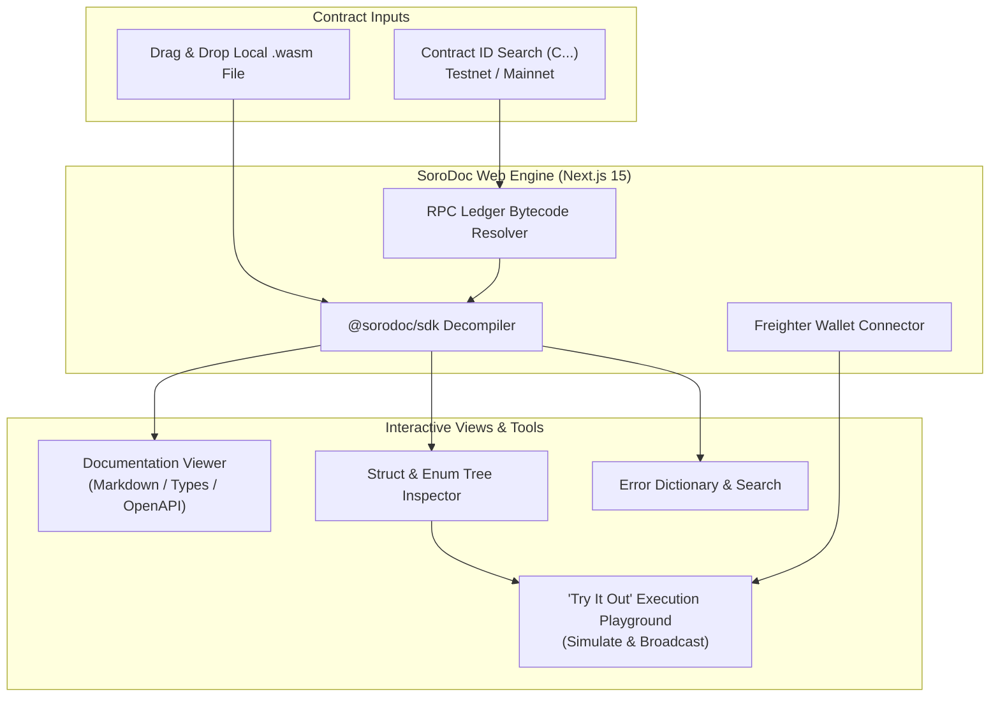

<div align="center">

# sorodoc-dashboard

### The Interactive "Swagger UI" & Contract Console for Stellar Soroban

[](https://github.com/SoroDoc-Studio/sorodoc-dashboard/actions)
[](https://nextjs.org/)
[](https://tailwindcss.com/)
[](https://vercel.com)
[](https://stellar.org/soroban)
[](https://opensource.org/licenses/MIT)

**The automated smart contract documentation engine and interactive "Swagger UI" for the Stellar Soroban ecosystem.**

[Live Demo](#-live-demo--interactive-showcase) • [Key Features](#-key-features--capabilities) • [Architecture](#-architecture--security-boundaries) • [Local Setup](#-local-development-setup) • [Deployment](#-deployment-guide) • [Contributing](#-contributing)

</div>

---

## 🌐 Live Demo & Interactive Showcase

Experience SoroDoc Dashboard directly in your web browser:

- **🚀 Live Production Console:** [https://sorodoc.vercel.app](https://sorodoc.vercel.app)
- **⚡ Pre-Loaded Testnet Showcase:** [Inspect Token Contract on Testnet](https://sorodoc.vercel.app/contract/CDLZFC3SYJYDZT7K67VZ75HPJVIEUVNIXF47ZG2FB2RMQQVU2HHGCYSC?network=testnet)
- **📦 Drag-and-Drop WASM Inspector:** Upload any compiled `.wasm` file directly to parse and inspect its interface in milliseconds.

---

## 📖 Overview

Before SoroDoc, interacting with on-chain Soroban contracts meant reading raw Rust source code or deserializing opaque XDR streams. **SoroDoc Dashboard** brings the intuitive, familiar experience of Swagger UI / OpenAPI into the Web3 Stellar ecosystem.

It functions as an interactive web explorer that decompiles binary WebAssembly metadata into visual schema inspectors, live documentation tabs, client interface code generators, and an interactive contract playground.

---

## 🎯 Key Features & Capabilities



### 1. 🔍 Universal Contract Lookup & Drag-and-Drop Wasm
- **Direct On-Chain Lookup:** Paste any 56-character Soroban Contract ID (`C...`) to query the persistent ledger state, resolve the WASM bytecode hash, and reconstruct the full contract interface.
- **Client-Side WASM Parsing:** Drag and drop your locally compiled `.wasm` binary directly into the browser. Extraction executes instantaneously in client memory with zero server uploads.

### 2. ⚡ Interactive "Try It Out" Playground
- Connect your **Freighter Wallet** with a single click.
- Auto-generated dynamic form controls for all contract parameters (primitives, structs, tuples, and vectors).
- **Pre-Flight Simulation:** Simulate contract invocations against Soroban RPC to inspect authorization requirements, ledger footprints, and expected return values before broadcasting live transactions.
- **Transaction Submission:** Sign and broadcast contract calls directly through Freighter with instant transaction hash explorer links.

### 3. 🌳 Struct & Enum Tree Explorer
- Inspect complex user-defined data structures (UDTs) with recursive type tree visualization.
- View field documentation comments, optionality flags, and primitive type equivalents at a glance.

### 4. ⚠️ Comprehensive Error Dictionary
- Searchable error reference mapping numeric Soroban error codes (e.g., `Error(Contract, #1001)`) to plain-English Rust enum names and descriptions written by contract authors.

### 5. 🔗 Deep-Linking & Team Collaboration
- Generate persistent, shareable URLs containing the contract address and network parameter (e.g. `?network=testnet`) to share documentation directly with frontend engineers, partners, and auditors.

---

## 🏗️ Architecture & Security Boundaries

`sorodoc-dashboard` is built with **Next.js 15 (App Router)**, **React 19**, and **Tailwind CSS**, adhering to strict Web3 security standards:

1. **SDK as Single Source of Truth:** The dashboard imports `@sorodoc/sdk` for all specification decompilation, AST normalization, and code formatting. No parsing logic is reinvented in frontend components.
2. **Zero Private-Key Custody:** SoroDoc Dashboard **never** requests, reads, or stores private keys or seed phrases. All transaction signing is strictly delegated to the user's browser extension wallet (`@stellar/freighter-api`).
3. **Client-Side WASM Guardrails:** Uploads are evaluated entirely in browser memory. A strict 15MB file size limit and 0-byte validation guard against memory exhaustion attacks.
4. **Read-Only RPC Queries:** Contract code retrieval queries the public Soroban RPC ledger state using standard `getLedgerEntries` calls without requiring privileged credentials.

---

## 💻 Local Development Setup

### Prerequisites
- **Node.js**: `>= 20.0.0` (or Node 18 LTS)
- **npm**: `>= 10.0.0` (or `pnpm`)
- **Git**

### 1. Clone and Install
```bash
git clone https://github.com/SoroDoc-Studio/sorodoc-dashboard.git
cd sorodoc-dashboard
npm install
```

### 2. Configure Environment Variables
Create a `.env.local` file in the root directory:

```bash
# Public Soroban RPC Endpoints
NEXT_PUBLIC_STELLAR_TESTNET_RPC=https://soroban-testnet.stellar.org
NEXT_PUBLIC_STELLAR_MAINNET_RPC=https://soroban-rpc.mainnet.stellar.org
NEXT_PUBLIC_DEFAULT_NETWORK=testnet
```

### 3. Start Development Server
```bash
npm run dev
```

Open [http://localhost:3000](http://localhost:3000) in your browser.

### 4. Run Quality Gates
```bash
# Static TypeScript checking
npm run typecheck

# Component and integration tests
npm test

# Production build test
npm run build
```

---

## 🚀 Deployment Guide

### Deploy to Vercel (One-Click)

The easiest way to deploy `sorodoc-dashboard` is using Vercel:

[](https://vercel.com/new/clone?repository-url=https%3A%2F%2Fgithub.com%2FSoroDoc-Studio%2Fsorodoc-dashboard)

1. Click the **Deploy** button above.
2. Link your GitHub account and create a new repository.
3. Add the `NEXT_PUBLIC_STELLAR_TESTNET_RPC` environment variable.
4. Click **Deploy**. Vercel will build and serve your production instance.

---

## 🤝 Contributing

We welcome contributions from developers, designers, and Stellar community members! Review our [CONTRIBUTING.md](./CONTRIBUTING.md) guide and [ARCHITECTURE.md](./ARCHITECTURE.md) to get started.

---

## 📄 License

This project is open-source software licensed under the [MIT License](./LICENSE).
